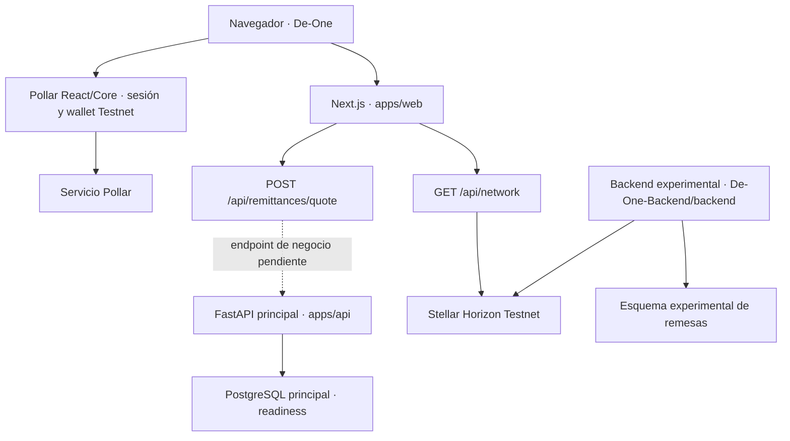

# De-One

**Remesas que acercan familias. Pagas en tu moneda; tu familia recibe en la suya.**

De-One propone simplificar el envío de dinero desde Brasil hacia Bolivia para que el usuario no tenga que comprar criptoactivos, coordinar operaciones P2P y resolver por su cuenta la entrega final. El producto inicial es un **servicio de remesas**, con recepción digital y una futura opción de retiro en agentes cercanos. Una billetera de uso general pertenece a una etapa posterior.

> **Estado para la ideathon: prototipo en desarrollo, orientado a Stellar Testnet.** Hay interfaz de producto, integración cliente con Pollar y un backend experimental de remesas. El recorrido fiat → USDC → fiat todavía no está integrado de extremo a extremo. Este repositorio no acredita un servicio financiero operativo ni una entrega real de bolivianos.

**Revisión documental:** 18 de octubre de 2026. Código base revisado: `db62427`, rama `main`. Nombre técnico del monorepo: `remesas-latam`. Repositorio: [srllamadev/stellar-De-One](https://github.com/srllamadev/stellar-De-One).

## Contenido

- [Problema, usuarios y propuesta](#problema-usuarios-y-propuesta)
- [Modelo de negocio y validación](#modelo-de-negocio-y-validación)
- [Por qué Stellar y qué aporta Pollar](#por-qué-stellar-y-qué-aporta-pollar)
- [Qué existe hoy](#qué-existe-hoy)
- [Arquitectura y mapa del repositorio](#arquitectura-y-mapa-del-repositorio)
- [Instalación y ejecución](#instalación-y-ejecución)
- [Variables de entorno](#variables-de-entorno)
- [API y persistencia](#api-y-persistencia)
- [Recorrido de demostración](#recorrido-de-demostración)
- [Pruebas y evidencia](#pruebas-y-evidencia)
- [Limitaciones y seguridad](#limitaciones-y-seguridad)
- [Roadmap y equipo](#roadmap-y-equipo)
- [Problemas frecuentes](#problemas-frecuentes)
- [Documentación y referencias](#documentación-y-referencias)

## Problema, usuarios y propuesta

### El problema que queremos validar

El contexto aportado por el equipo describe a personas bolivianas que trabajan en manufactura en Brasil y envían dinero a sus familias. Parte de ese público resuelve hoy el recorrido comprando USDT y coordinando un intercambio P2P para obtener BOB. Ese proceso exige conocimientos, varios pasos y confianza en contrapartes distintas.

Es una **hipótesis de usuario inicial**, no el resultado de un estudio de mercado publicado en este repositorio. Falta medir frecuencia, importe habitual, costo total, incidentes y preferencias de cobro mediante entrevistas y pruebas de concepto.

### La propuesta De-One

1. El remitente identifica al destinatario y solicita una cotización.
2. Antes de pagar, conoce el costo total, el cambio, la vigencia y el importe neto en destino.
3. De-One coordina las integraciones y presenta el estado de la operación.
4. El destinatario recibe BOB por un canal local habilitado o, en una etapa posterior, retira efectivo en un agente De-One.

Este es el **flujo objetivo**. Actualmente la interfaz no procesa PIX ni entrega BOB. La expansión hacia Argentina es una posibilidad que se evaluará después de validar el primer corredor; la existencia de un proveedor multirregional no activa automáticamente un corredor para De-One.

### Diferenciación que debe demostrar el piloto

La apuesta es reducir la complejidad del recorrido completo y acercar el punto de recepción, con información clara y soporte. No se afirma que De-One sea hoy más barato o más rápido que otras alternativas.

| Alternativa | Qué comparar en el mismo envío | Hipótesis de De-One |
|---|---|---|
| Exchanges y P2P | BOB netos, pasos, contraparte y tiempo | Evitar que la familia coordine compraventas |
| Meru y Takenos | Recorrido completo, cambio, comisiones y retiro | Especialización en el corredor y acompañamiento |
| Bancos y remesadoras | Requisitos, importe recibido y acceso al cobro | Una experiencia simple y cercana |
| Tarjetas | Si permiten remesar a otra persona o principalmente pagar compras | Resolver la entrega al destinatario |

La comparación propuesta es: **con el mismo total de BRL pagado, cuántos BOB recibe la familia, en cuánto tiempo y con qué esfuerzo**. No se publican tarifas actuales de competidores sin una comparación verificable.

## Modelo de negocio y validación

El objetivo inicial del equipo es probar el flujo, cubrir los costos necesarios y reinvertir, sin remuneración inicial de fundadores. Eso expresa una intención de operación, no una demostración de sostenibilidad.

| Elemento | Hipótesis del proyecto |
|---|---|
| Segmento inicial | Bolivianos que trabajan en Brasil y envían dinero a familiares en Bolivia |
| Propuesta de valor | Coordinar el envío y la recepción sin exigir gestión manual de cripto/P2P |
| Canales de adquisición | Contacto directo con familias y comunidades vinculadas a manufactura; referidos por validar |
| Relación con el cliente | Transparencia previa, seguimiento y soporte durante la entrega |
| Ingreso previsto | Comisión por remesa, pendiente de validar contra el costo completo |
| Costos | Infraestructura, servicios de IA, proveedores, identidad, soporte, operación y futura red de agentes |
| Actividades clave | Integrar proveedores, cotizar, conciliar, atender incidentes y verificar la entrega |
| Recursos y socios necesarios | Equipo técnico, infraestructura, proveedores habilitados y acuerdos operativos de cobro/pago |
| Meta de piloto | Conseguir y observar los primeros 100 clientes; no equivale a 100 clientes adquiridos |

### Hipótesis de tarifa

El equipo propone cobrar un porcentaje **X todavía no definido** hasta un equivalente de US$200 y una tarifa plana de US$2 por encima. Es una propuesta comercial pendiente de validar, **no una tarifa implementada ni una promesa para cualquier monto**.

Si se quisiera continuidad matemática en US$200, X tendría que ser 1%; esto no prueba que esa tarifa cubra costos. También faltan la moneda de cobro, la conversión del umbral, los límites de operación y la remuneración de los agentes.

La cotización del backend experimental usa otra regla: **1% del importe BRL, sin ese tope**, y un cambio fijo de demostración. No representa el modelo comercial final.

La métrica económica del piloto será:

```text
contribución por envío = ingreso efectivamente cobrado − costo variable total
punto de equilibrio = costos fijos / contribución positiva media por envío
```

Medir por separado entrega bancaria, retiro en efectivo e ingreso de efectivo en origen. No se presupone que las comisiones de proveedores permanecen fijas cuando crece el monto.

### Agentes De-One: expansión propuesta

Se plantea una red de retiro cercana al destinatario, con un límite inicial propuesto de **Bs1.000**. Falta definir si sería por operación, día o persona. Es una política de producto en discusión, no un límite normativo confirmado.

La red no está implementada. Se necesitan acuerdos, disponibilidad y reposición de caja, remuneración, conciliación, responsabilidad ante incidentes y un mecanismo que impida el doble cobro. El equipo reporta conversaciones exploratorias con un banco boliviano; este repositorio no contiene un convenio firmado ni evidencia de liquidez disponible.

La referencia a agentes BCP es una analogía de experiencia de cobro: **no implica afiliación ni alianza con BCP**. La identidad y el código de retiro, su vencimiento y sus controles están pendientes de diseño. Tampoco está decidido si el receptor de efectivo necesitará instalar la aplicación.

## Por qué Stellar y qué aporta Pollar

### Stellar como capa prevista de transferencia

La arquitectura objetivo es:

```text
BRL por un medio local → conversión a USDC → transferencia en Stellar
→ conversión por un proveedor habilitado → BOB para el destinatario
```

Stellar permite representar activos y registrar transferencias con identificadores verificables. Testnet permite experimentar sin atribuir valor monetario a los activos de prueba. La elección busca separar la experiencia de remesa de la infraestructura de activos digitales. Véanse las [redes oficiales de Stellar](https://developers.stellar.org/docs/networks) y su [documentación](https://developers.stellar.org/docs).

**Lo que prueba el código experimental es más acotado:** construye una transferencia de **1 XLM de Testnet entre cuentas de demostración**. No mueve el importe BRL cotizado, no implementa USDC y no verifica la entrega de BOB. No se necesitan contratos Soroban para ese ejercicio.

### Pollar como integración de experiencia y wallet

El frontend declara `@pollar/core` y `@pollar/react`, resueltos en **0.11.5** en el lock. Usa el provider y los flujos oficiales para sesión, wallet, balances, historial y preparación de envíos. La integración se carga en cliente; no hay un paquete `@pollar/sdk`.

[Pollar](https://www.pollar.xyz/) presenta medios locales e infraestructura de pagos. Esa oferta no acredita que De-One tenga habilitado el corredor completo ni resuelve por sí sola sus acuerdos operativos. La implementación concreta debe contrastarse con el [SDK oficial](https://github.com/pollar-xyz/pollar) y la [documentación](https://docs.pollar.xyz/), porque los ejemplos y las versiones pueden diferir.

En este repositorio:

- `ProductProvider` solo monta Pollar si la clave pública empieza por `pub_testnet_`.
- El cliente se configura con `stellarNetwork: "testnet"` y `confirmation: "prompt"`.
- Los balances y movimientos se muestran a partir de una sesión verificada; un dato ausente no se convierte en un saldo ficticio.
- El historial visible se filtra por Stellar Testnet y enlaza hashes válidos al explorador.
- El backend principal mantiene su adapter Pollar deshabilitado. Su variable `POLLAR_ENABLED` **no controla** el provider del navegador.

Una clave presente, una sesión verificada, una wallet preparada y una transacción confirmada son estados diferentes. Ninguno acredita, por sí solo, que un familiar cobró fiat.

## Qué existe hoy

La tabla distingue código presente de integración y prueba de extremo a extremo.

| Capacidad | Estado del repositorio | Evidencia o límite |
|---|---|---|
| Interfaz De-One | Implementada | Login/registro, dashboard, envío, recepción, historial y perfil en `apps/web/src` |
| Acceso y wallet Pollar | Integración cliente implementada | Requiere clave, configuración de proyecto y sesión; no se probó con credenciales en esta revisión |
| QR de recepción | Implementado | Codifica una dirección pública Stellar; no es un QR de pago bancario boliviano |
| Envío digital Testnet | Flujo del SDK conectado | Abre la revisión de Pollar con sesión y wallet preparadas; no prueba fiat → fiat |
| Consulta BRL → BOB en la UI | Interfaz y proxy presentes | Responde indisponibilidad; falta el endpoint correspondiente en FastAPI principal |
| Health, ready y Swagger | Implementados en API principal | Contratos verificables, independientes de la API experimental |
| Registro experimental de usuarios/remesas | Implementado por separado | SQL directo en `De-One-Backend/backend`; no integrado con el frontend Next.js |
| Cotización experimental | Simulada | `Decimal("1.30")` BOB/BRL y 1% de comisión; no es cambio de mercado |
| Liquidación experimental | Código Testnet | Prepara hash/XDR y envía 1 XLM de demostración; no se ejecutó aquí |
| PostgreSQL y migraciones principales | Configurados | Compose y baseline Alembic; sin tablas financieras en esa baseline |
| PIX, USDC y entrega bancaria BOB | Pendientes | No hay un corredor real habilitado en esta aplicación |
| Agentes, retiro físico y billetera de pagos | Propuestos | Sin implementación ni operación acreditada |

## Arquitectura y mapa del repositorio

### Dos aplicaciones backend, con responsabilidades y madurez diferentes

**API principal:** `apps/api`, iniciada por `npm run dev:api` y por Compose. Es la base modular de infraestructura y solo expone health/ready como endpoints propios.

**Backend experimental:** `De-One-Backend/backend`, con otro `pyproject.toml` y otro `uv.lock`. Contiene el ejercicio de remesas, SQL directo y Stellar SDK Python. No lo arranca Compose, no lo cubre el workflow actual y no sustituye automáticamente a `apps/api`.



El cliente de health conserva `NEXT_PUBLIC_API_URL`. El proxy de cotizaciones usa `API_INTERNAL_URL`. El estado de Horizon se consulta desde una ruta de Next.js; no pasa por la API FastAPI principal.

### Estructura de trabajo

```text
stellar-De-One/
├── apps/
│   ├── web/
│   │   ├── src/app/                 Páginas y rutas HTTP de Next.js
│   │   ├── src/features/            Auth, dashboard, transfers, wallet, history
│   │   ├── src/providers/           ProductProvider y bridge de Pollar
│   │   ├── src/components/          Shell, componentes y diagnóstico
│   │   ├── src/lib/                 Cliente health y configuración de Pollar
│   │   ├── src/config/              Variables públicas
│   │   ├── public/
│   │   └── Dockerfile
│   └── api/
│       ├── app/                     api, core, schemas, models y capas reservadas
│       ├── alembic/versions/        Baseline 0001_bootstrap
│       ├── tests/                   Pruebas de infraestructura
│       ├── pyproject.toml
│       ├── uv.lock
│       └── Dockerfile
├── De-One-Backend/
│   ├── backend/                    Prototipo independiente de remesas/Stellar
│   └── frontend/                   HTML/CSS/JS del prototipo, separado de Next.js
├── deone_db.sql                     Archivo binario pg_dump, no SQL plano
├── packages/contracts/              Reserva para contratos compartidos
├── infra/                          Notas de Docker/PostgreSQL
├── docs/                           Arquitectura, API, integración y equipo
├── scripts/                        Setup, smoke y árbol
├── .github/workflows/ci.yml
├── compose.yaml
├── package.json
└── package-lock.json
```

`npm run tree` obtiene el árbol real respetando `.gitignore`. Hay carpetas y documentos reservados de Fase 0: su existencia no implica que una funcionalidad esté implementada.

### Stack

| Área | Tecnologías / versiones resueltas principales |
|---|---|
| Frontend | Next.js 16.4.2, React 19.3.0, TypeScript 5.9.3, Tailwind CSS 4.3.3 |
| Wallet cliente | `@pollar/core` 0.11.5, `@pollar/react` 0.11.5, `qrcode` |
| API principal | Python 3.12, FastAPI 0.143.3, Pydantic 2.14.1, SQLAlchemy 2.0.55, psycopg 3.3.6, Alembic |
| API experimental | FastAPI, SQLAlchemy 2.1.5, psycopg, `stellar-sdk` 16.1.0; lock independiente |
| Infraestructura | PostgreSQL 17 Alpine, Docker Compose, GitHub Actions |
| Calidad | ESLint, TypeScript, Ruff, pytest |
| Dependencias | npm workspaces para web; uv para cada proyecto Python |

Los archivos de bloqueo fijan las versiones completas. No mezclar los dos entornos Python: sus restricciones de SQLAlchemy son diferentes.

## Instalación y ejecución

### Requisitos

- Git, Node.js 22.14+ dentro de la línea 22 y npm 10/11; referencia en `.nvmrc` y `package.json`.
- Python 3.12 y [uv](https://docs.astral.sh/uv/getting-started/installation/).
- Docker Engine/Desktop con Compose v2 para PostgreSQL y el stack completo.
- En Windows, PowerShell y contenedores Linux para Docker Desktop.

No hace falta una cuenta Pollar para revisar la UI sin sesión ni para ejecutar los tests de `apps/api`. Para login, balances y operaciones del SDK sí hace falta un proyecto Testnet válido.

### Preparar el monorepo

```sh
git clone https://github.com/srllamadev/stellar-De-One.git
cd stellar-De-One
npm ci
uv sync --directory apps/api --frozen
npm run setup
```

`setup` copia los ejemplos a `.env`, `apps/web/.env.local` y `apps/api/.env` solo si el destino no existe. No sincroniza archivos locales ya creados ni configura el backend experimental. Tras actualizar el código, ejecutar `npm ci` antes de atribuir un error de módulo ausente a la aplicación.

### Modo local, sin operar con Pollar

Desde la raíz, en una terminal:

```sh
npm run dev:api
```

En otra terminal PowerShell, dejar la clave vacía solo para ese proceso:

```powershell
$env:NEXT_PUBLIC_POLLAR_PUBLISHABLE_KEY = ""
npm run dev:web
```

Equivalente en bash/zsh:

```sh
NEXT_PUBLIC_POLLAR_PUBLISHABLE_KEY="" npm run dev:web
```

Abrir [login](http://localhost:3000/login) o [dashboard](http://localhost:3000/dashboard). Se puede explorar la interfaz sin iniciar sesión; las operaciones requieren las comprobaciones de sesión correspondientes. Las páginas explorables no equivalen a autorización backend.

Sin PostgreSQL, health puede responder 200 y ready 503. Para agregar persistencia local:

```sh
npm run db:up
npm run db:migrate
```

### Modo completo con Docker

```sh
docker compose config --quiet
docker compose up --build
```

Desde otra terminal:

```sh
docker compose exec api uv run --no-sync alembic upgrade head
```

| Servicio | Dirección del host | Dirección interna de Compose |
|---|---|---|
| Web | `http://localhost:3000` | `web:3000` |
| API principal | `http://localhost:8000` | `api:8000` |
| PostgreSQL | `localhost:5433` | `db:5432` |

Compose espera a la salud de db antes de API y a ready antes de web. Incluye volumen persistente y montajes de desarrollo. `docker compose down` detiene el stack; no añadir `-v` si se necesitan los datos. `npm run db:down` solo detiene db.

El Compose actual deja la clave Pollar del navegador vacía. Si se habilita el proxy de negocio dentro de Docker en el futuro, `API_INTERNAL_URL` debe ser `http://api:8000`; hoy Compose no la inyecta y el endpoint de cotización tampoco está implementado en esa API.

### Backend experimental: ejecución separada y opcional

Requiere una base **exclusiva para pruebas**, con el esquema experimental previamente revisado y preparado. Crear manualmente `De-One-Backend/backend/.env` con `DATABASE_URL` apuntando a esa base. No reutilizar datos personales ni restaurar el dump sobre una base existente.

```sh
uv sync --directory De-One-Backend/backend --frozen
uv run --directory De-One-Backend/backend uvicorn main:app --host 127.0.0.1 --port 8001
```

Swagger de ese proceso: `http://localhost:8001/docs`. Se propone 8001 para evitar el conflicto con la API principal en 8000. Estos comandos no integran los dos backends ni crean las tablas experimentales mediante Alembic.

El frontend HTML experimental tiene `http://127.0.0.1:8000` fijado en su JavaScript y sus orígenes CORS son `localhost:5500`/`127.0.0.1:5500`. No apunta automáticamente al ejemplo de puerto 8001 anterior: usar ese frontend requiere alinear explícitamente puerto, origen y API. No es el frontend Next.js.

## Variables de entorno

| Archivo / consumidor | Variable | Significado |
|---|---|---|
| `.env` raíz / Compose | `POSTGRES_DB`, `POSTGRES_USER`, `POSTGRES_PASSWORD` | BD y credenciales locales configurables |
| `apps/web/.env.local` / navegador | `NEXT_PUBLIC_API_URL` | URL pública para el cliente de health; normalmente `http://localhost:8000` |
| `apps/web/.env.local` / navegador | `NEXT_PUBLIC_POLLAR_PUBLISHABLE_KEY` | Clave publicable Testnet; vacía para revisar sin Pollar |
| `apps/web/.env.local` / servidor Next.js | `API_INTERNAL_URL` | Base para el proxy de cotización; host local o `http://api:8000` en Docker |
| `apps/api/.env` | `APP_ENV` | `development` o `test` |
| `apps/api/.env` | `DATABASE_URL` | URL `postgresql+psycopg://...`; localhost:5433 en host, db:5432 en Docker |
| `apps/api/.env` | `FRONTEND_URL` | Origen CORS exacto, por defecto `http://localhost:3000` |
| `apps/api/.env` | `POLLAR_ENABLED`, `POLLAR_SECRET_KEY` | Adapter backend pendiente; false por defecto, secreto solo en backend |
| `apps/api/.env` | `STELLAR_NETWORK` | Solo `testnet` admitido en la API principal |
| `De-One-Backend/backend/.env` | `DATABASE_URL` | Conexión independiente al esquema experimental |
| Backend experimental | `DEMO_ADMIN_TOKEN` | Habilita la autorización local del endpoint de liquidación; nunca enviarlo al navegador |
| Backend experimental | `.cuentas_testnet` | Archivo privado opcional con identidades de prueba; solo para un ensayo Testnet separado y autorizado |

La API principal resuelve su `.env` por ruta de proyecto; el prototipo usa `load_dotenv()` desde su contexto de ejecución. Las variables de proceso prevalecen en la configuración principal.

El ejemplo web versionado contiene una clave **publicable** Testnet; no es una clave secreta, pero su presencia no garantiza acceso, dominio permitido ni disponibilidad del proyecto. Para una demostración propia, configurar el proyecto del equipo; para una revisión aislada, dejarla vacía. No se reproduce su valor en este documento.

Reiniciar Next.js tras cambiar variables públicas; el build incorpora `NEXT_PUBLIC_*`. Nunca colocar seeds, claves secretas, tokens de administración ni contraseñas de BD en variables con ese prefijo. Los `.env` locales y `.cuentas_testnet` están ignorados por Git.

## API y persistencia

### API principal: contrato comprobable

| Método | Ruta | Respuesta |
|---|---|---|
| GET | `/api/v1/health` | 200: `{"status":"ok","service":"remesas-api","version":"0.1.0"}` |
| GET | `/api/v1/ready` | 200: `{"status":"ready","database":"up"}` o 503: `{"status":"not_ready","database":"down"}` |
| GET | `/docs` | Swagger UI |
| GET | `/openapi.json` | Especificación OpenAPI |

Health indica que el proceso está vivo. Ready ejecuta `SELECT 1`; no verifica Pollar, tablas financieras ni entrega de fondos. SQLAlchemy usa sesiones por request y libera el engine al apagar la aplicación.

### Rutas de Next.js

| Método | Ruta | Comportamiento actual |
|---|---|---|
| GET | `/api/network` | Consulta Horizon Testnet y verifica la passphrase de red; puede devolver 503 |
| POST | `/api/remittances/quote` | Comprueba Origin/Host, limita el cuerpo y consulta el endpoint de negocio previsto |

El proxy solicita `/api/v1/remittances/quote`. Esa ruta **no existe en `apps/api`** y no es `/cotizar` del prototipo. Actualmente el proxy convierte la indisponibilidad en HTTP 503; **no presenta una cotización ni inicia una remesa**. Su lógica tampoco acepta todavía una cotización exitosa como contrato de negocio.

### Endpoints del backend experimental

Estas rutas solo corresponden al proceso opcional de `De-One-Backend/backend`:

| Método | Ruta | Alcance |
|---|---|---|
| GET | `/`, `/db-test` | Estado básico y consulta de BD |
| GET | `/cotizar?monto=...` | Cálculo simulado, sin cotización de mercado |
| POST | `/cotizaciones?monto=...` | Guarda la cotización simulada con vencimiento de cinco minutos |
| POST | `/usuarios` | Registro experimental de datos de usuario |
| POST / GET | `/remesas` | Registro y listado experimental |
| GET | `/remesas/{id_remesa}`, `/remesas/{id_remesa}/detalle` | Consulta de la remesa y referencias Stellar |
| POST | `/remesas/{id_remesa}/simular-pago` | Marca pago simulado; no procesa PIX |
| GET | `/stellar/status`, `/stellar/cuentas/{direccion}` | Consultas a Testnet |
| POST | `/stellar/transacciones` | Registra un hash después de comprobar éxito en Testnet |
| POST | `/remesas/{id_remesa}/liquidar-testnet` | Operación de demostración protegida con `X-Demo-Token` |
| GET | `/remesas/{id_remesa}/verificar-stellar` | Reconcilia el hash pendiente; puede actualizar la BD pese a usar GET |

No hay autenticación/autorización integral de usuarios en ese prototipo. El token de liquidación no protege todos los endpoints. No publicar este proceso como un servicio abierto.

### Esquemas y dinero

La baseline `apps/api/alembic/versions/0001_bootstrap.py` es válida y no crea tablas de negocio. Los modelos principales no definen todavía usuarios, remesas o wallets.

`deone_db.sql`, a pesar de su extensión, tiene cabecera **`PGDMP`**: es un archivo binario de `pg_dump` en formato custom. Incluye definiciones y secciones de datos de `usuarios`, `cotizaciones`, `remesas` y `transacciones_stellar`. No es un seed anonimizado validado ni una migración de Alembic.

No usar `psql -f deone_db.sql`. Con herramientas PostgreSQL instaladas, `pg_restore --list deone_db.sql` permite inspeccionar el contenido antes de decidir una restauración aislada. Esa restauración y la anonimización de sus datos están pendientes de validación en esta revisión.

El prototipo usa claves enteras, importes `Numeric` y timestamps con zona horaria. La convención futura de la API modular propone UUID; todavía requiere una migración acordada. Los cálculos experimentales usan `Decimal`. El frontend convierte valores a `Number` para mostrarlos, por lo que ese formateo no debe reutilizarse como motor contable.

El flujo de liquidación guarda hash y XDR antes del envío, y conserva `verificacion_pendiente` ante incertidumbre. Una confirmación Stellar deja la remesa en `procesando`: **confirmación de red no significa entrega de BOB**. Falta completar conciliación, autorización, correspondencia de activo/importe/destino y manejo de concurrencia antes de una operación real.

## Recorrido de demostración

### Sin credenciales y sin transacciones

1. Instalar dependencias y arrancar web con la clave Pollar vacía.
2. Abrir `/login` y usar **Explorar De-One** para entrar al dashboard.
3. Recorrer `/dashboard`, `/send`, `/receive`, `/history` y `/profile`.
4. Comprobar que los datos no disponibles aparecen como pendientes o vacíos, sin inventar una identidad, saldo o transferencia.
5. En el modo Brasil → Bolivia de `/send`, observar que no se promete un importe BOB sin proveedor de cotización. Puede comprobarse la respuesta de indisponibilidad sin pagar ni firmar.
6. Consultar health, ready y OpenAPI de la API principal para diferenciar interfaz, proceso y persistencia.

### Con proyecto Pollar Testnet del equipo

Configurar una clave publicable propia y los dominios permitidos. El acceso se realiza mediante el modal oficial. Perfil permite comprobar estado de sesión y wallet; recepción muestra una dirección/QR; historial muestra registros devueltos por el proveedor.

Una prueba que cree wallets, firme o envíe activos debe planificarse aparte y limitarse a Testnet. Esta revisión documental **no ejecutó** login, generación de cuentas, financiación ni transacciones. No hay aquí un hash nuevo ni un comprobante de pago que se presente como resultado de esta revisión.

## Pruebas y evidencia

### Comandos disponibles desde la raíz

```sh
npm run lint:web
npm run typecheck:web
npm run build:web
npm run lint:api
npm run test:api
npm run verify
```

`verify` encadena los cinco controles y se detiene en el primer fallo. El ámbito Python es `apps/api/tests`; no cubre el backend experimental. No ejecutar descubrimiento indiscriminado de tests desde la raíz: algunos scripts experimentales tienen llamadas, generación de identidades o interacción a nivel de módulo.

El test real de PostgreSQL requiere `TEST_DATABASE_URL` apuntando a una BD dedicada. Si falta, pytest lo marca como omitido; eso no acredita conectividad. El resto comprueba health, JSON, CORS, configuración Testnet y ready con sesión simulada.

### Estado de la revisión del 18 de octubre de 2026

La revisión incluye lectura de rutas, providers, endpoints, persistencia, locks y workflow. Las solicitudes web se hicieron por HTTP con la clave Pollar vacía, sin login ni firma; no sustituyen pruebas de interacción en navegador.

| Comprobación | Resultado de esta revisión |
|---|---|
| `npm run verify` | APROBADO: ESLint, TypeScript, Ruff, pytest y build de Next.js finalizaron con código 0 |
| Tests Python de API principal | 10 aprobados y 1 omitido: falta TEST_DATABASE_URL para PostgreSQL real |
| Build web | APROBADO: páginas de producto y rutas dinámicas de red/cotización compiladas |
| API principal health y `/docs` | HTTP 200 comprobado |
| API principal ready | HTTP 503, database down; no hay PostgreSQL disponible |
| OpenAPI principal | Solo health y ready como rutas propias, comprobado |
| Instalación de dependencias | `npm install` completado; SDK core/react 0.11.5 disponibles, sin cambios en package.json ni lock |
| Frontend sin Pollar | `/login`, `/dashboard`, `/send`, `/receive`, `/history` y `/profile`: HTTP 200 y HTML De-One después de instalar |
| Proxy de cotización | HTTP 503: `El servicio de cotizaciones no está habilitado.` |
| `npm run smoke` | FALLA: la aserción `/remesas-latam/` no coincide con el HTML De-One actual; health y Swagger sí aprobaron |
| Auditoría npm de producción | `npm audit --omit=dev`: cero vulnerabilidades reportadas |
| Auditoría npm completa | Cinco alertas altas en la cadena de herramientas ESLint/fast-glob/micromatch/braces; sin aplicar cambios forzados |
| Docker / PostgreSQL / restauración | No ejecutados: Docker, psql y pg_restore no están instalados |
| Backend experimental | Revisión estática y sintáctica; sin ejecutar escrituras ni liquidación |
| Pollar y movimientos Testnet | No ejecutados con credenciales |

`scripts/smoke.mjs` pertenece al bootstrap y busca el texto `remesas-latam` en la página raíz. La raíz actual muestra la introducción De-One y redirige a login/dashboard; esa aserción quedó desactualizada y falló en esta revisión. El script se detiene allí antes de su comprobación de ready; ready se consultó por separado. No se modificó el test para presentar un resultado verde en una entrega de documentación.

La primera ejecución local de la web devolvió HTTP 500 por `Can't resolve '@pollar/react'`: las dependencias instaladas eran anteriores al código actual. Después de `npm install` y de reiniciar Next.js, las seis rutas anteriores respondieron 200. Las alertas npm completas son de dependencias de desarrollo; véase [GHSA-vfj7-8cjw-p6xm](https://github.com/advisories/GHSA-vfj7-8cjw-p6xm). Cero alertas de producción reportadas no constituye una auditoría de seguridad integral.

Pytest también emitió un aviso de deprecación de Starlette sobre el uso de httpx en TestClient; no impidió completar la suite. Se verificaron los enlaces locales y el índice de este README, además de `git diff --check`. Esta entrega cambia únicamente `README.md`; no modifica lógica financiera, contratos, tests ni infraestructura para alterar sus resultados.

### CI existente

`.github/workflows/ci.yml` define:

- **web:** instalación con lock, ESLint, TypeScript y build.
- **api:** PostgreSQL dedicado, Ruff, tests y baseline Alembic upgrade/check/downgrade.
- **compose:** validación y arranque del stack, smoke HTTP y migración en contenedor.

Es configuración versionada, no evidencia de que el último run remoto haya aprobado. El job Compose depende del smoke de bootstrap descrito arriba. El backend experimental, sus contratos y su dump no están cubiertos por este workflow. No hay una suite E2E automatizada de remesas fiat.

## Limitaciones y seguridad

La ideathon muestra una propuesta y un prototipo; quedan estos límites concretos:

1. **Backends separados:** el frontend no consume todavía el registro de remesas experimental. Hay que unificar contratos, configuración y ownership de datos.
2. **Cotización pendiente:** el proxy Next.js no tiene un endpoint de negocio operativo en la API principal. El cambio fijo experimental no debe ofrecerse como tasa ejecutable.
3. **Liquidación demostrativa:** el envío Python de 1 XLM no representa el importe de una remesa ni una conversión a USDC.
4. **Autorización incompleta:** verificar una sesión en el navegador no protege endpoints Python. Faltan validación de identidad del lado servidor y controles de acceso por recurso.
5. **Asociación de hashes:** comprobar `successful` en Stellar no basta para asociar una transacción a una remesa; verificar origen, destino, activo, monto, red y vínculo con la operación esperada.
6. **Sin autorización operativa acreditada:** no se aportan en el repositorio acuerdos bancarios, habilitaciones, proveedores contratados ni una red de agentes en producción. Validarlos antes de operar dinero real.
7. **Datos y secretos:** no usar PII real en la demo. Revisar el dump antes de compartirlo o restaurarlo. Nunca publicar `.env`, `.cuentas_testnet`, seeds ni tokens; el XDR firmado del prototipo también debe tratarse como material sensible durante su vigencia.
8. **No Mainnet:** el alcance de este proyecto y de su evaluación es Testnet. La selección de red del cliente no sustituye el aislamiento y los controles del backend.
9. **Disponibilidad externa:** una conexión a Horizon no acredita una sesión Pollar; una wallet financiada no acredita que su preparación interna esté completa.
10. **Documentación histórica:** algunos README de subcarpetas y documentos de Fase 0 todavía describen SDK ausente o carpetas reservadas. Este README registra el estado observado actual; esos documentos deben actualizarse al consolidar la integración.

No hay garantía de entrega instantánea, tarifa mínima del mercado, cobertura en todos los países ni liquidación bancaria demostrada. Las pruebas técnicas no sustituyen la validación operativa del servicio.

## Roadmap y equipo

### Siguiente entrega técnica

- Unificar el contrato de remesas entre Next.js y una API de negocio; conservar health/ready.
- Integrar el esquema experimental mediante migraciones revisadas, sin restauraciones implícitas.
- Actualizar smoke y ampliar CI para el backend que vaya a quedar como principal.
- Probar sesión Pollar, estado de wallet y transferencias Testnet con evidencia reproducible.
- Agregar pruebas de autorización, idempotencia, concurrencia, vencimiento y conciliación.
- Reemplazar el cambio simulado por una cotización verificable solo cuando exista un proveedor habilitado.

### Validación de producto y operación

- Entrevistar a familias del segmento inicial y medir su recorrido actual.
- Validar la meta de 100 clientes y registrar adquisición, frecuencia, monto y canal preferido.
- Confirmar costos de proveedores y calcular contribución por envío antes de fijar X o el tope.
- Formalizar alcance del piloto, límites, soporte, reembolsos y responsabilidades con los socios.
- Evaluar pocos agentes de retiro antes de ampliar una red; Argentina y billetera de pagos quedan después de validar el corredor inicial.

### Responsabilidades

| Integrante | Área principal | Coordinación necesaria |
|---|---|---|
| 1 — Frontend | `apps/web/` | Consume contratos acordados; integra experiencia Pollar |
| 2 — Backend | Rutas, schemas, servicios, dominio e integraciones | Acuerda modelos con integrante 3 y define contrato de consolidación del prototipo |
| 3 — Base de datos y DevOps | Modelos, repositorios, Alembic, `infra/`, Compose y CI | Administra todas las migraciones y la incorporación del esquema experimental |

Los archivos compartidos requieren coordinación. Nadie modifica otra área sin comunicarlo y acordarlo. El backend experimental debe integrarse con sus responsables; no se presupone que migrarlo sea copiar archivos dentro de `apps/api`.

### Contribución

Una raíz Git y rama principal `main`. Usar ramas por tarea, commits pequeños y pull requests. Convenciones iniciales: `feat/frontend`, `feat/backend`, `feat/database-devops`. Conventional Commits: `feat:`, `fix:`, `chore:`, `docs:`, `refactor:` y `test:`.

Instalar dependencias web desde raíz con `npm install <paquete> --workspace @remesas/web`. Para Python usar `uv add --directory <proyecto> <paquete>`. Versionar los locks y no mezclar los entornos. Cada PR debe indicar qué se probó y qué quedó pendiente. Véanse [WORKFLOW](docs/team/WORKFLOW.md) y [TASKS](docs/team/TASKS.md).

## Problemas frecuentes

| Síntoma | Comprobación / acción |
|---|---|
| `Can't resolve '@pollar/react'` o `qrcode` | Ejecutar `npm ci` desde raíz tras actualizar la rama; reiniciar Next.js |
| Pollar no aparece | Clave vacía o sin prefijo Testnet; revisar configuración local y reiniciar el proceso |
| Login del proveedor falla | Revisar dominio permitido, métodos habilitados y disponibilidad del proyecto; no inventar una sesión local |
| La wallet está financiada pero Pollar informa fallo | Consultar su estado oficial; no volver a financiar ni atribuir READY por leer Horizon |
| `/send` informa que no hay cotización | Es el límite actual: falta proveedor y endpoint integrado; no es una confirmación de remesa |
| `/cotizar` devuelve 404 en API principal | Esa ruta pertenece al backend experimental, no a `apps/api` |
| Ready devuelve 503 | Revisar BD, puerto y DATABASE_URL; health puede seguir en 200 |
| CORS rechaza `127.0.0.1` | Usar el origen exacto de FRONTEND_URL; localhost y 127.0.0.1 son orígenes distintos |
| Proxy falla en Docker | `localhost:8000` dentro de web es el contenedor web; el destino interno sería `api:8000` |
| Credenciales BD cambiadas en `.env` no funcionan | El volumen conserva la inicialización anterior; gestionar el cambio sin borrar datos a ciegas |
| `deone_db.sql` no abre como SQL | Es un dump custom PGDMP; inspeccionarlo con pg_restore, no con psql -f |
| Smoke falla aunque las pantallas respondan | Revisar su aserción histórica de `remesas-latam` y distinguirla del estado de servicios |
| `docker` no se reconoce | Instalar y arrancar Docker/Compose; no marcar PostgreSQL o Compose como comprobados antes de ejecutarlos |

## Documentación y referencias

### Código para revisar por responsabilidad

- [Provider Pollar](apps/web/src/providers/product-provider.tsx), [env web](apps/web/src/config/env.ts) y [estado de integración](apps/web/src/lib/pollar/config.ts).
- [Flujo de envío](apps/web/src/features/transfers/send-screen.tsx), [QR de recepción](apps/web/src/features/wallet/receive-screen.tsx) e [historial](apps/web/src/features/history/activity.tsx).
- [Proxy de cotización](apps/web/src/app/api/remittances/quote/route.ts) y [consulta de red](apps/web/src/app/api/network/route.ts).
- [API principal](apps/api/app/main.py), [health/ready](apps/api/app/api/v1/endpoints/status.py), [tests](apps/api/tests/) y [baseline](apps/api/alembic/versions/0001_bootstrap.py).
- [API experimental](De-One-Backend/backend/main.py), [cotización simulada](De-One-Backend/backend/cotizaciones.py), [reserva/hash/XDR](De-One-Backend/backend/control_liquidacion.py), [servicio de liquidación](De-One-Backend/backend/servicio_liquidacion.py) y [transferencia Testnet](De-One-Backend/backend/liquidacion_stellar.py).
- [Compose](compose.yaml), [workflow](.github/workflows/ci.yml) y [scripts](scripts/).

### Documentos de referencia

- [Arquitectura inicial](docs/architecture/README.md) y [contrato de infraestructura](docs/api/README.md).
- [Investigación Pollar de Fase 0](docs/integrations/pollar/README.md): antecedente fechado; no sustituye el provider actual ni una prueba con cuenta.
- [Informe histórico del bootstrap](docs/BOOTSTRAP_REPORT.md): sus resultados corresponden a aquella revisión, no a esta versión completa.
- [Next.js](https://nextjs.org/docs), [FastAPI](https://fastapi.tiangolo.com/), [SQLAlchemy](https://docs.sqlalchemy.org/), [Alembic](https://alembic.sqlalchemy.org/), [uv](https://docs.astral.sh/uv/) y [Docker Compose](https://docs.docker.com/compose/).
- [Stellar](https://developers.stellar.org/docs), [redes](https://developers.stellar.org/docs/networks), [Pollar](https://www.pollar.xyz/), [SDK](https://github.com/pollar-xyz/pollar) y [documentación Pollar](https://docs.pollar.xyz/).

El material de negocio aportado para redactar este README describe PDFs, un pitch y un video. Esos archivos no están versionados en esta copia del repositorio; no se presentan enlaces de demo pública ni comprobantes que no puedan verificarse aquí.

### Licencia

Esta copia del repositorio no contiene un archivo `LICENSE`. No se declara una licencia de distribución del proyecto en este README. Las dependencias conservan sus propias licencias; el equipo debe definir la del proyecto antes de publicarlo con una autorización de uso específica.
